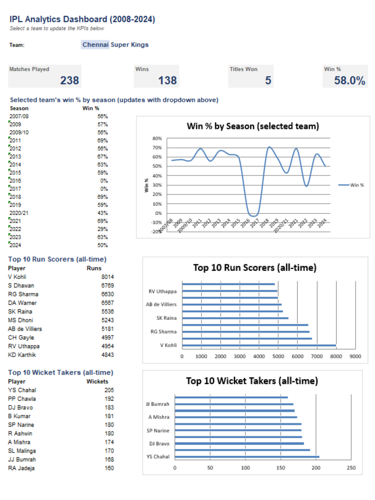

# IPL Analytics 2008–2024

An Excel-based analysis of 17 seasons of the Indian Premier League (IPL), built from 1,095 matches and 260,920 ball-by-ball deliveries. The workbook has 10 sheets, including an interactive team dashboard, batting and bowling leaderboards, a phase-wise run rate analysis and a historical win probability model for run chases.

## Objective

To turn raw ball-by-ball IPL data into a clean, structured and easy-to-explore analysis that answers questions such as:

- Which teams have the best all-time records?
- Who are the top run scorers and wicket takers?
- How has scoring changed across powerplay, middle and death overs?
- How likely is a chase to succeed, given the overs left and runs required?

## Dataset

- **Source:** IPL Complete Dataset (2008–2024) on Kaggle
- **Size:** 1,095 matches and 260,920 deliveries
- **Credit:** The data belongs to its original Kaggle author. I cleaned and analysed it, but did not collect it.

## Data cleaning

- Standardised franchise renames (Delhi Daredevils to Delhi Capitals, Kings XI Punjab to Punjab Kings, Royal Challengers Bangalore to Bengaluru)
- Fixed a team name typo (Rising Pune Supergiant / Supergiants)
- Handled missing toss, result and venue values
- Kept defunct franchises separate from the later teams of the same city

## Workbook structure

| Sheet | What it contains |
|---|---|
| Read Me | Project overview, data source and sheet guide |
| Dashboard | Pick a team from the dropdown to update its KPIs (matches, wins, titles, win %), a season-wise win % chart, and top 10 run scorer and wicket taker charts |
| Matches | Cleaned match table with 1,095 rows covering teams, venue, toss, result and margins |
| Deliveries | Cleaned ball-by-ball table with 260,920 rows, the base for all analysis |
| Team Season Summary | Wins, losses, titles and win % for each team in each season |
| Team Overall Summary | All-time record for each franchise, which feeds the Dashboard |
| Batting Leaderboard | 168 batters (minimum 300 balls faced): runs, strike rate, average, 50s and 100s |
| Bowling Leaderboard | 190 bowlers (minimum 300 legal balls): wickets, economy, average and strike rate |
| Phase Analysis | Run rate in the powerplay, middle and death overs by season, plus team-wise splits |
| Win Probability Model | Historical chase success rates by overs left and runs required, with a live calculator |

## Excel features used

- Dropdown-driven dashboard using `INDEX`, `MATCH` and `SUMPRODUCT`
- Data validation for the team selector and the win probability calculator
- Charts: line chart for season-wise win %, bar charts for top run scorers and wicket takers, and a phase run rate chart
- Conditional formatting on the win probability matrix
- Live formulas for win %, strike rate, economy, averages and run rate, which recalculate if the base counts change

## Key findings

- **Virat Kohli** is the top run scorer in the dataset with 8,014 runs, including 8 hundreds. **YS Chahal** leads the bowlers with 205 wickets.
- **Chris Gayle** has the most sixes among players in the leaderboard, with 359.
- **Chennai Super Kings** have the best win rate (58.0%) among teams with 100 or more matches. **Mumbai Indians** and Chennai have won 5 titles each.
- Scoring has risen sharply. The league-wide powerplay run rate went from 7.70 in 2008 to 9.46 in 2024, and the death overs from 10.31 to 11.44.
- Winning the toss gave only a small edge: toss winners won 50.8% of matches that had a result. Teams that chose to field won 53.9% of the time, against 45.4% for teams that chose to bat.
- In the chase model, needing 20 to 30 runs with 2 overs left has historically been close to a coin flip, while needing 40 or more off the last over has almost never succeeded.

## How the win probability model works

The model uses more than 27,000 second-innings snapshots taken at every over boundary of every chase from 2008 to 2024. Each snapshot is grouped by overs remaining and runs required, and the matrix shows the share of those chases that were won. The calculator on the same sheet looks up the matching cell for any combination you choose.

## How to use

1. Download `IPL_Analytics_2008-2024.xlsx` from this repository. It is about 14 MB.
2. Open it in Microsoft Excel (desktop version recommended so dropdowns and charts work properly).
3. Start with the **Read Me** sheet, then go to the **Dashboard** and pick a team.

## Limitations

- The win probability model is a historical lookup table, not a machine learning model. It does not account for batting strength, venue or the current batters.
- Leaderboard aggregates (leaderboards, phase splits and the win probability matrix) were calculated once from the 260,920-row Deliveries sheet. Rates and ratios shown on top of them are live formulas over those counts.
- Leaderboards include only players above the minimum ball thresholds (300 balls faced or bowled).
- Results depend on the quality and completeness of the Kaggle dataset.

## Author

**Manu B R**
B.Sc. Physical Science with Computer Science, University of Delhi (2026)
LinkedIn: [linkedin.com/in/manubr369](https://linkedin.com/in/manubr369)
GitHub: [github.com/manubr369](https://github.com/manubr369)
Email: manubaburaj3@gmail.com
